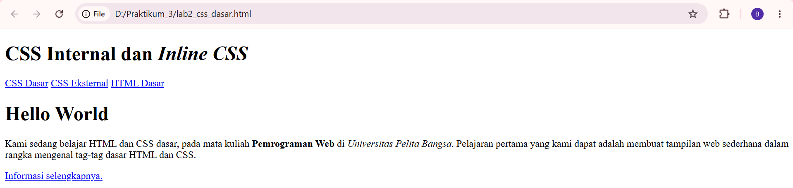
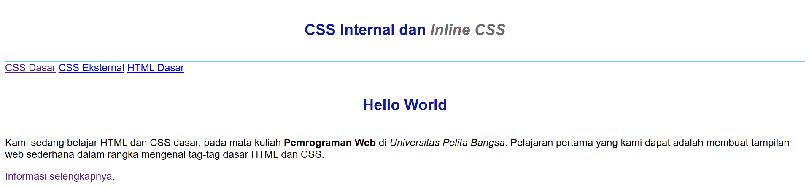
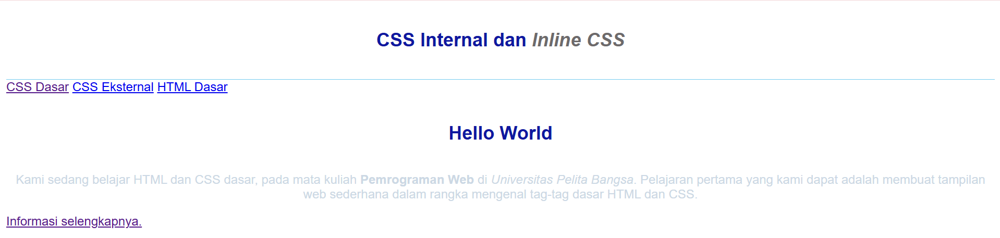
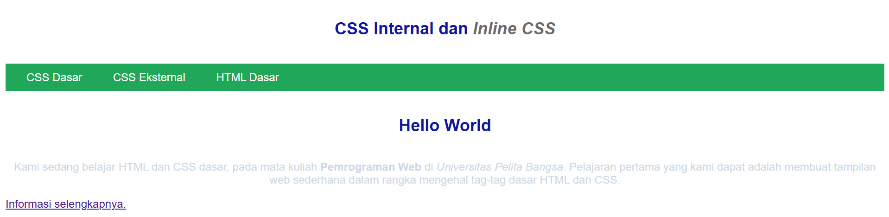
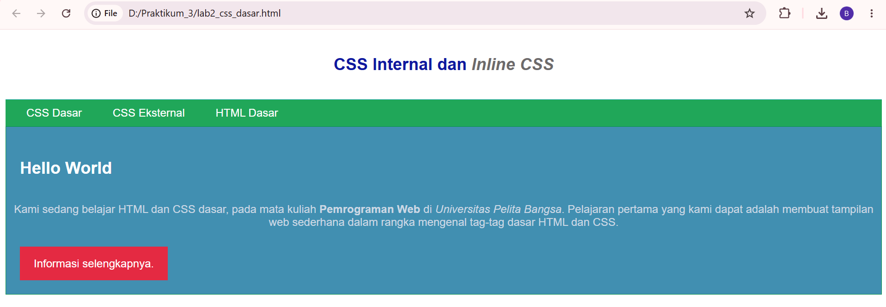
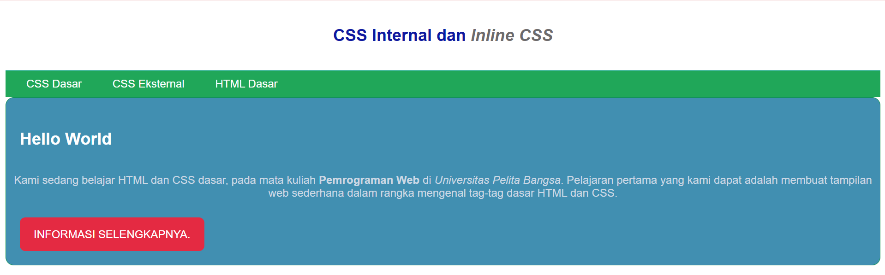

# Laporan Praktikum 3 - Pemrograman Web
## CSS Dasar

### Identitas Mahasiswa
* *Nama:* Berliansa
* *NIM:* 312510324
* *Mata Kuliah:* Pemrograman Web

---

## Langkah-Langkah Praktikum dan Penjelasan

### Langkah 1: Membuat Dokumen HTML Dasar
Membuat file lab2_css_dasar.html untuk menyusun kerangka HTML5 polos yang berisi struktur header, nav, dan container div ber-ID intro. Langkah ini bertujuan untuk menyediakan konten mentah sebelum nantinya diatur tampilannya menggunakan CSS.

### Langkah 2: Mendeklarasikan CSS Internal
Menambahkan tag style di dalam head dokumen untuk mengatur jenis font body, batas bawah header, serta warna dan posisi judul h1 agar berada di tengah. Fungsinya adalah memberikan visual dasar agar halaman web terlihat lebih rapi dan terstruktur.

### Langkah 3: Menambahkan Inline CSS
Menuliskan atribut gaya secara langsung di dalam tag paragraf menggunakan kode p style="text-align: center; color: #ccd8e4;". Langkah ini berfungsi untuk mengubah teks paragraf tersebut menjadi rata tengah dan memodifikasi warnanya secara spesifik pada baris itu saja.

### Langkah 4: Membuat CSS Eksternal
Membuat file terpisah bernama style_eksternal.css untuk mengatur tampilan menu navigasi (nav), memberikan warna latar belakang hijau, teks putih, serta efek hover saat didekati kursor, lalu menghubungkannya menggunakan tag link. Tujuannya agar pengelolaan kode gaya menjadi terpusat pada satu file saja.

### Langkah 5: Menambahkan CSS Selector (ID dan Class Selector)
Menambahkan kode ID Selector (#intro) untuk membungkus area konten utama dengan latar belakang biru, serta Class Selector (.button & .btn-primary) untuk menyulap tautan/link biasa menjadi tombol visual kotak berwarna merah. Fungsinya untuk memberikan identitas gaya yang kuat pada elemen unik (ID) dan membuat komponen tombol yang fleksibel untuk digunakan kembali (Class).

---

## Pertanyaan dan Tugas (Jawaban)

### 1. Lakukan eksperimen dengan mengubah dan menambah properti dan nilai pada kode CSS dengan mengacu pada CSS Cheat Sheet yang diberikan pada file terpisah dari modul ini.
* *Jawaban:* Eksperimen mandiri dilakukan pada file style_eksternal.css dengan menambahkan properti border-radius untuk melengkungkan sudut komponen konten, properti box-shadow untuk memberikan efek bayangan estetis pada container #intro agar terlihat lebih berdimensi, serta properti text-transform: uppercase pada .button untuk mengubah teks tombol secara otomatis menjadi huruf kapital. Berikut adalah bukti screenshot visual web hasil modifikasi eksperimen tersebut:

### 2. Apa perbedaan pendeklarasian CSS elemen h1 {...} dengan #intro h1 {...}? Berikan penjelasannya!
* *Jawaban:* Elemen h1 {...} adalah Element Selector yang otomatis mengatur seluruh tag h1 di halaman tersebut. Sedangkan #intro h1 {...} adalah Descendant Selector yang hanya mengatur tag h1 yang berada di dalam elemen dengan id="intro".

### 3. Apabila ada deklarasi CSS secara internal, lalu ditambahkan CSS eksternal dan inline CSS pada elemen yang sama. Deklarasi manakah yang akan ditampilkan pada browser? Berikan penjelasan dan contohnya!
* *Jawaban:* Yang akan ditampilkan adalah Inline CSS karena memiliki kasta/prioritas tertinggi dalam CSS Cascade dibanding internal dan eksternal.
* *Contoh:* Jika eksternal diatur p { color: red; }, tetapi di bagian tag HTML ditulis p style="color: blue;" Teks /p, maka teks di browser akan berwarna biru.

### 4. Pada sebuah elemen HTML terdapat ID dan Class, apabila masing-masing selector tersebut terdapat deklarasi CSS, maka deklarasi manakah yang akan ditampilkan pada browser? Berikan penjelasan dan contohnya! (p id="paragraf-1" class="text-paragraf")
* *Jawaban:* Yang akan ditampilkan adalah aturan dari ID Selector (#paragraf-1) karena ID memiliki bobot spesifisitas yang jauh lebih tinggi (nilai 100) dibandingkan Class Selector (nilai 10).
* *Contoh:* Jika ditulis #paragraf-1 { color: green; } dan .text-paragraf { color: yellow; }, teks akan tetap berwarna hijau karena aturan ID selalu mengalahkan Class.